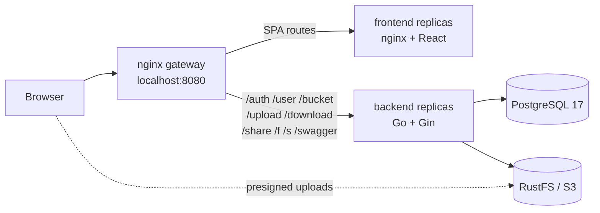

<div align="center">

# ObjexRG

**Self-hosted, S3-compatible object storage with a web drive UI.**

Upload, organize, share and download files through a React application backed by a
Go API, PostgreSQL and RustFS, with nginx load balancing across replicas.

[](https://go.dev/)
[](https://gin-gonic.com/)
[](https://react.dev/)
[](https://www.typescriptlang.org/)
[](https://vite.dev/)
[](https://tailwindcss.com/)
[](https://www.postgresql.org/)
[](https://docs.docker.com/compose/)
[](https://nginx.org/)

</div>

---

## Table of contents

- [Overview](#overview)
- [Features](#features)
- [Architecture](#architecture)
- [Tech stack](#tech-stack)
- [Quick start](#quick-start)
- [Services and ports](#services-and-ports)
- [Make targets](#make-targets)
- [Configuration](#configuration)
- [API reference](#api-reference)
- [Upload flow](#upload-flow)
- [Storage modes](#storage-modes)
- [Local development](#local-development)
- [Testing and quality](#testing-and-quality)
- [Operations](#operations)
- [Project structure](#project-structure)
- [Troubleshooting](#troubleshooting)
- [Security notes](#security-notes)

## Overview

ObjexRG is a full-stack object storage service. Users can create buckets, upload
files, control object visibility, generate share links and download files through
the browser.

The backend exposes a REST API documented with Swagger. The frontend is a React
SPA served by nginx. An edge nginx gateway load balances requests across backend
and frontend replicas while keeping everything on a single origin.

## Features

- **Authentication**: register, login, JWT access tokens and rotating refresh tokens.
- **Buckets**: create, list and delete per-user buckets.
- **Objects**: upload, list, download, delete and change visibility.
- **Direct uploads**: presigned S3 POST/PUT uploads straight to RustFS.
- **Proxy fallback**: streaming multipart upload and download when presigning is not available.
- **Sharing**: expiring share links and public object links.
- **Limits**: per-file upload limit with server-side enforcement.
- **Load balancing**: nginx gateway over multiple backend and frontend replicas.
- **API docs**: interactive Swagger UI at `/swagger/index.html`.
- **Persistence**: PostgreSQL for metadata and RustFS (S3-compatible) for blobs.

## Architecture



- The gateway routes known API prefixes to the backend pool and everything else
  to the frontend pool.
- Docker DNS plus nginx `least_conn` distribute traffic across replicas.
- Presigned uploads go directly from the browser to the public S3 endpoint.

## Tech stack

| Layer | Technology |
| --- | --- |
| Backend | Go 1.25, Gin, GORM |
| Auth | JWT (HS256), bcrypt, rotating refresh tokens |
| Database | PostgreSQL 17 |
| Object storage | RustFS (S3-compatible) or local filesystem |
| Frontend | React 19, TypeScript 6, Vite 8, Tailwind CSS 4 |
| HTTP client | Axios |
| Edge / static serving | nginx |
| Packaging | Docker, Docker Compose |
| API docs | Swagger (`swaggo`) |

## Quick start

### Prerequisites

- Docker Engine 24+ with Compose v2
- `make` (optional but recommended)

### Start the stack

```bash
cp .env.example .env
# Edit .env and set strong secrets before exposing the stack.

make up
```

Without `make`:

```bash
docker compose up -d --build
```

Open:

| Endpoint | URL |
| --- | --- |
| Web application | <http://localhost:8080> |
| Swagger UI | <http://localhost:8080/swagger/index.html> |
| RustFS console | <http://localhost:9001> |

The default stack starts **2 backend replicas** and **2 frontend replicas** behind
nginx. You can change the replica count:

```bash
make up BACKEND_REPLICAS=3 FRONTEND_REPLICAS=1
make scale BACKEND_REPLICAS=2 FRONTEND_REPLICAS=2
```

Useful commands:

```bash
make logs     # follow all logs
make ps       # show service status
make down     # stop the stack
```

## Services and ports

| Service | Host port | Internal port | Description |
| --- | --- | --- | --- |
| `gateway` | `8080` | `80` | nginx edge proxy and load balancer |
| `objexrg` | - | `7080` | Go API, scaled replicas |
| `frontend` | - | `80` | Static SPA served by nginx, scaled replicas |
| `postgres` | `5432` | `5432` | Metadata database |
| `rustfs` | `9000`, `9001` | `9000`, `9001` | S3 API and web console |
| `rustfs-init` | - | - | One-shot bucket bootstrap |

The backend and frontend are not published directly; all traffic enters through
the gateway at `http://localhost:8080`.

## Make targets

| Target | Description |
| --- | --- |
| `make up` | Build and start infra, backend, frontend and gateway |
| `make down` | Stop and remove the stack |
| `make restart` | Recreate the stack |
| `make logs` | Follow service logs |
| `make ps` | Show service status |
| `make images` | Build backend and frontend images |
| `make infra` | Start PostgreSQL, RustFS and the bucket bootstrap |
| `make backend` | Rebuild backend replicas (stack must be up) |
| `make frontend` | Rebuild frontend replicas (stack must be up) |
| `make scale` | Rescale replicas; gateway picks them up dynamically |
| `make build` | Compile the Go binary into `./bin` |
| `make run` | Run the API locally |
| `make dev-frontend` | Start the Vite dev server |
| `make tidy` | Run `go mod tidy` |
| `make fmt` | Format Go code |
| `make vet` | Run `go vet` |
| `make test` | Run Go tests |
| `make check` | Format, vet and test |
| `make swag` | Regenerate Swagger docs into `cmd/docs` |
| `make clean` | Remove build artifacts |

## Configuration

Configuration is read from environment variables. For local development, copy
`.env.example` to `.env`. Docker Compose also loads `.env` automatically.

### Backend

| Variable | Default | Description |
| --- | --- | --- |
| `DATABASE_URL` | required | PostgreSQL connection string |
| `JWT_ACCESS_SECRET` | required | Secret used to sign access tokens |
| `JWT_REFRESH_SECRET` | access secret + suffix | Secret used to sign refresh tokens |
| `PUBLIC_BASE_URL` | `http://localhost:7080` | Base URL for share/public links |
| `CORS_ALLOWED_ORIGINS` | local dev origins | Comma-separated allowed origins |
| `MAX_UPLOAD_BYTES` | `536870912` (512 MiB) | Maximum size per file |
| `STORAGE_DRIVER` | `local` | `local` or `s3` |
| `OBJEXRG_STORAGE_PATH` | `./data` | Blob directory for the local driver |
| `PRESIGN_TTL` | `15m` | Presigned URL lifetime (Go duration) |

### Object storage (S3 / RustFS)

| Variable | Default | Description |
| --- | --- | --- |
| `S3_ENDPOINT` | required for `s3` | Internal endpoint used by the backend |
| `S3_PUBLIC_ENDPOINT` | `S3_ENDPOINT` | Endpoint embedded in presigned URLs; must be reachable by the browser |
| `S3_ACCESS_KEY` | required for `s3` | S3 access key |
| `S3_SECRET_KEY` | required for `s3` | S3 secret key |
| `S3_BUCKET` | `objexrg` | Backing bucket name |
| `S3_REGION` | `us-east-1` | S3 region |
| `S3_USE_SSL` | `false` | Use HTTPS for the S3 endpoint |
| `S3_FORCE_PATH_STYLE` | `true` | Use path-style S3 URLs (required by RustFS) |

When the S3 driver is enabled in Docker, the backend uses
`S3_ENDPOINT=http://rustfs:9000` internally and
`S3_PUBLIC_ENDPOINT=http://localhost:9000` for browser uploads/downloads.

### Docker Compose

| Variable | Default | Description |
| --- | --- | --- |
| `DB_USER` | `postgres` | PostgreSQL user |
| `DB_PASSWORD` | `prkal34` | PostgreSQL password |
| `DB_NAME` | `objexrg_credentials` | PostgreSQL database |
| `GATEWAY_PUBLIC_URL` | `http://localhost:8080` | Public base URL behind the gateway |
| `RUSTFS_ACCESS_KEY` | `rustfsadmin` | RustFS access key |
| `RUSTFS_SECRET_KEY` | `rustfsadmin` | RustFS secret key |
| `RUSTFS_CORS_ALLOWED_ORIGINS` | `*` | Allowed origins for the S3 API |
| `VITE_API_URL` | `/` | API base URL baked into the frontend build |

Change all default credentials and secrets before deploying.

### Frontend build

| Variable | Default | Description |
| --- | --- | --- |
| `VITE_API_URL` | `http://localhost:7080` (source) / `/` (Docker) | API base URL used by Axios |

In Docker the SPA calls the API through the gateway on the same origin (`/`). For
local development it calls `http://localhost:7080` directly.

## API reference

All protected endpoints require `Authorization: Bearer <access_token>`.

### Authentication and users

| Method | Path | Auth | Description |
| --- | --- | --- | --- |
| `POST` | `/auth/register` | No | Create an account |
| `POST` | `/auth/login` | No | Get access and refresh tokens |
| `POST` | `/auth/refresh` | No | Rotate the refresh token |
| `POST` | `/auth/logout` | No | Revoke a refresh token |
| `GET` | `/user/me` | Yes | Current user profile |
| `PATCH` | `/user/me` | Yes | Update the current profile |

### Buckets and objects

| Method | Path | Auth | Description |
| --- | --- | --- | --- |
| `POST` | `/bucket` | Yes | Create a bucket |
| `GET` | `/bucket` | Yes | List buckets |
| `DELETE` | `/bucket/{bucket}` | Yes | Delete a bucket |
| `GET` | `/bucket/{bucket}` | Yes | List objects |
| `GET` | `/bucket/{bucket}/storage` | Yes | List bucket storage entries |
| `PATCH` | `/bucket/{bucket}/objects/{filename}` | Yes | Set object visibility |
| `DELETE` | `/bucket/{bucket}/objects/{filename}` | Yes | Delete an object |
| `GET` | `/bucket/{bucket}/objects/{filename}/link` | Yes | Get a presigned object link |

### Uploads and downloads

| Method | Path | Auth | Description |
| --- | --- | --- | --- |
| `POST` | `/upload/{bucket}` | Yes | Multipart/proxy upload |
| `POST` | `/upload/{bucket}/presign` | Yes | Reserve a key and get a presigned upload target |
| `POST` | `/upload/{bucket}/finalize` | Yes | Register a directly uploaded blob |
| `GET` | `/download/{bucket}/{filename}` | Yes | Stream a file download |

### Sharing and public links

| Method | Path | Auth | Description |
| --- | --- | --- | --- |
| `POST` | `/share/{bucket}/{filename}` | Yes | Create an expiring share link |
| `GET` | `/share/list` | Yes | List share links |
| `GET` | `/f/{id}` | No | Access a public object |
| `GET` | `/s/{token}` | No | Access a shared file |

### Documentation

| Method | Path | Auth | Description |
| --- | --- | --- | --- |
| `GET` | `/swagger/*any` | No | Swagger UI and OpenAPI assets |

Interactive documentation: <http://localhost:8080/swagger/index.html>

## Upload flow

1. The client calls `POST /upload/{bucket}/presign` with `fileName`, `sizeBytes`
   and `mimeType`.
2. The API validates the file size limit, reserves a storage key and returns a
   presigned `POST` (preferred) or `PUT` target.
3. The browser uploads the file directly to RustFS using `S3_PUBLIC_ENDPOINT`.
4. The client calls `POST /upload/{bucket}/finalize` with `fileName` and
   `storageKey`.
5. The API verifies the blob exists, checks its size and records the object in
   PostgreSQL.

When presigning is unavailable, the frontend falls back to the multipart proxy
endpoint `POST /upload/{bucket}`.

## Storage modes

### Local filesystem

```env
STORAGE_DRIVER=local
OBJEXRG_STORAGE_PATH=./data
```

Blobs are stored under the configured directory using the same
`{ownerID}/{bucket}/{storageKey}` layout as the S3 driver.

### S3-compatible storage

```env
STORAGE_DRIVER=s3
S3_ENDPOINT=http://rustfs:9000
S3_PUBLIC_ENDPOINT=http://localhost:9000
S3_ACCESS_KEY=rustfsadmin
S3_SECRET_KEY=rustfsadmin
S3_BUCKET=objexrg
S3_REGION=us-east-1
S3_FORCE_PATH_STYLE=true
```

`S3_ENDPOINT` is used for backend operations. `S3_PUBLIC_ENDPOINT` is used only to
sign URLs that the browser will call, so it must be reachable from the client.

## Local development

### Infrastructure

Start PostgreSQL, RustFS and the bucket bootstrap:

```bash
make infra
```

### Backend

```bash
cp .env.example .env
# Adjust DATABASE_URL and secrets if needed.
go run ./cmd/main.go
```

The API listens on `http://localhost:7080`.

If you change Swagger annotations, regenerate the docs:

```bash
go install github.com/swaggo/swag/cmd/swag@v1.8.1
make swag
```

### Frontend

```bash
cd frontend
bun install
bun run dev
```

The Vite dev server runs on `http://localhost:5173` and calls the API at
`http://localhost:7080`. To point it elsewhere, create `frontend/.env`:

```env
VITE_API_URL=http://localhost:7080
```

## Testing and quality

```bash
make check    # go fmt, go vet and go test
make test     # go test ./...
make vet      # go vet ./...
make fmt      # go fmt ./...
```

Frontend checks:

```bash
cd frontend
bun run lint
bun run build
```

## Operations

### Logs and status

```bash
make ps
make logs
```

### Scaling

```bash
make scale BACKEND_REPLICAS=3 FRONTEND_REPLICAS=2
```

The nginx gateway resolves replicas dynamically through Docker DNS, so new
replicas receive traffic without restarting the stack.

### Stop and reset

```bash
make down                # stop containers, keep volumes
docker compose down -v   # stop containers and delete PostgreSQL/RustFS data
```

**Warning:** `docker compose down -v` permanently removes stored objects and
database contents.

### Rebuild a single tier

```bash
make backend
make frontend
```

## Project structure

```text
objexrg/
├── cmd/                      # API entrypoint and generated Swagger docs
├── internal/
│   ├── config/               # Environment configuration
│   ├── dtos/                 # Request and response types
│   ├── handlers/http/        # Gin handlers and routes
│   ├── infrastructure/       # Database, repositories and blob stores
│   ├── interfaces/           # Service/storage contracts
│   ├── middleware/           # Auth and CORS middleware
│   ├── models/               # GORM models
│   ├── services/             # Auth, bucket, storage and user logic
│   ├── shared/               # Shared result helpers
│   └── validators/           # Request validators
├── frontend/                 # React SPA, Dockerfile and nginx config
├── nginx/nginx.conf          # Edge gateway and load balancer
├── docs/                     # Architecture notes
├── plan.md                   # Planned work (storage quotas)
├── Dockerfile                # Backend multi-stage image
├── docker-compose.yml        # Full stack definition
├── Makefile                  # Developer commands
└── README.md
```

## Troubleshooting

| Symptom | Resolution |
| --- | --- |
| Browser shows `rustfs:9000` / `ERR_NAME_NOT_RESOLVED` | Set `S3_PUBLIC_ENDPOINT` to an endpoint the browser can reach, then recreate the backend replicas. |
| Upload works via API but fails in the browser | Check RustFS CORS (`RUSTFS_CORS_ALLOWED_ORIGINS`) and that the public S3 port is reachable. |
| Session lost after reload | Confirm `/auth/refresh` returns `200` through the gateway and that you are running the latest frontend image. |
| `make: command not found` | Use `docker compose up -d --build` directly. |
| Port already in use | Change the host port mapping in `docker-compose.yml` or stop the conflicting service. |
| Swagger shows stale docs | Run `make swag` and rebuild the backend. |
| Frontend cannot reach the API in local dev | Set `VITE_API_URL=http://localhost:7080` in `frontend/.env` and restart Vite. |

## Security notes

- Replace all default passwords and secrets in `.env` before deploying.
- Never commit `.env`; use a secret manager in production.
- Terminate TLS in front of the gateway or configure nginx with certificates.
- In production, restrict access to the RustFS console (`9001`) and S3 API
  (`9000`) to the networks that need them.
- Access tokens are kept in memory; refresh tokens are stored in `localStorage`.
  Moving refresh tokens to secure `HttpOnly` cookies is recommended for
  high-security deployments.
- Keep dependencies updated and run `make check` plus the frontend build before
  publishing changes.
